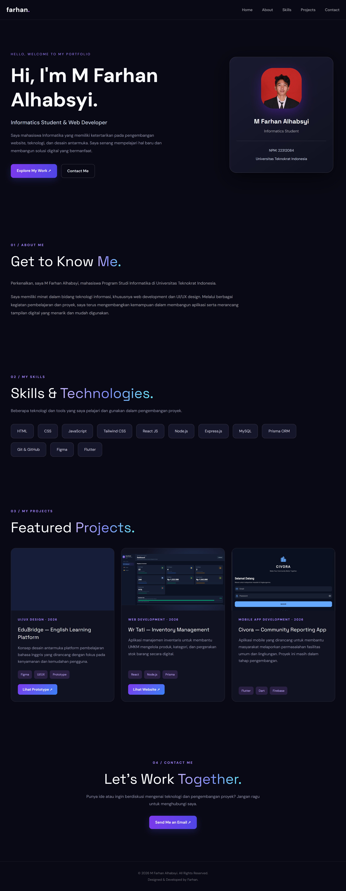

# Portfolio Website — M Farhan Alhabsyi

Website portofolio pribadi untuk Praktikum Pemrograman Web 2 — Latihan 3.

## Identitas Mahasiswa

- **Nama:** M Farhan Alhabsyi
- **NPM:** 22312084
- **Program Studi:** Informatika
- **Universitas:** Universitas Teknokrat Indonesia

## Teknologi

- HTML5
- Tailwind CSS
- JavaScript
- Vite

## Fitur

- Responsive design
- About Me
- Skills & Technologies
- Featured Projects
- Contact Section
- Responsive navigation menu

## Screenshot

### Desktop View



### Mobile View


## Menjalankan Project

Install dependencies:

```bash
npm install
```

Jalankan development server:

```bash
npm run dev
```

Build production:

```bash
npm run build
```

Preview production:

```bash
npm run preview
```

---

Dibuat oleh M Farhan Alhabsyi — 2026