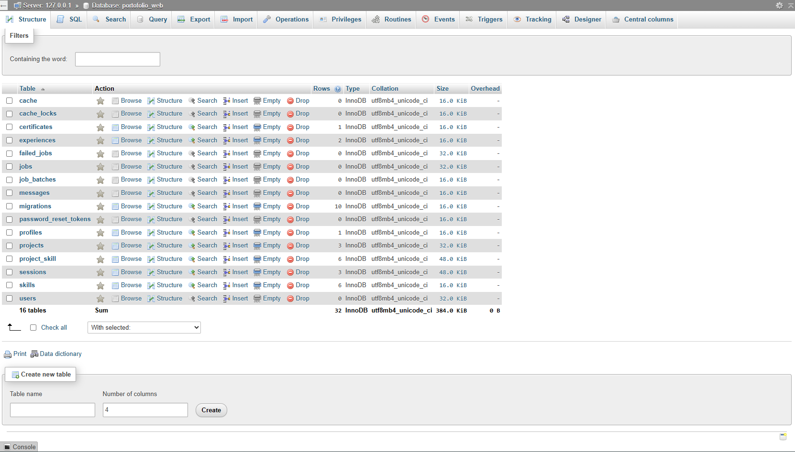
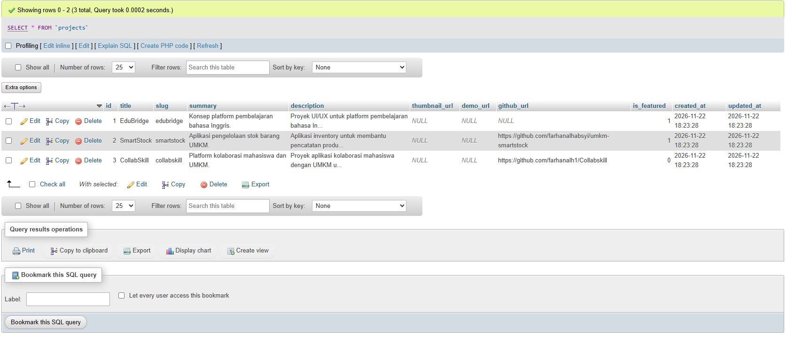
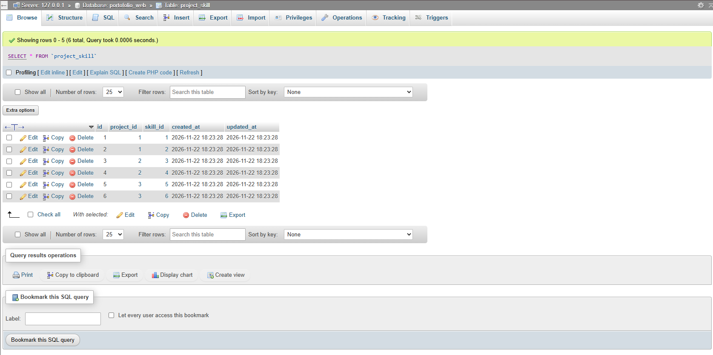

# Latihan 4a — Setup Laravel

## Identitas Mahasiswa

- **Nama:** M Farhan Alhabsyi
- **NPM:** 22312084
- **Program Studi:** Informatika
- **Universitas:** Universitas Teknokrat Indonesia
- **Kelas:** IF 23C

## Deskripsi

Latihan ini merupakan pengenalan framework Laravel dengan membuat project Laravel, mengatur koneksi database MySQL, memahami struktur folder Laravel, serta menampilkan halaman identitas mahasiswa menggunakan Controller dan Blade Template.

Halaman identitas menampilkan informasi mahasiswa, versi Laravel, status koneksi database, dan nama database yang sedang digunakan.

## Teknologi dan Versi

| Teknologi | Versi |
|---|---|
| PHP | 8.2.12 |
| Laravel | 11.57.1 |
| Database | MySQL |
| Template Engine | Blade |

### Alasan Memilih Versi

PHP 8.2 dipilih karena kompatibel dengan Laravel 11 dan tersedia pada lingkungan pengembangan XAMPP yang digunakan.

Laravel 11 dipilih karena merupakan framework PHP modern yang memiliki struktur MVC, routing, controller, Blade Template, serta fitur migration untuk pengelolaan database.

Versi tersebut sesuai untuk mempelajari dasar pengembangan aplikasi web menggunakan Laravel.

## Struktur Folder Laravel

| Folder | Fungsi |
|---|---|
| `app/` | Menyimpan kode utama aplikasi, seperti Controller, Model, dan logika aplikasi. |
| `bootstrap/` | Berisi proses awal aplikasi Laravel dan konfigurasi bootstrap. |
| `config/` | Menyimpan file konfigurasi aplikasi, database, mail, dan layanan lainnya. |
| `database/` | Menyimpan migration, seeder, dan factory untuk pengelolaan database. |
| `public/` | Direktori publik yang menjadi titik masuk aplikasi web melalui `index.php`. |
| `resources/` | Menyimpan view Blade, file CSS, JavaScript, dan sumber daya aplikasi. |
| `routes/` | Menyimpan definisi route atau alamat URL aplikasi. |
| `storage/` | Menyimpan log, cache, file session, dan file hasil proses aplikasi. |
| `tests/` | Menyimpan file pengujian aplikasi. |
| `vendor/` | Berisi library dan dependency PHP yang dipasang melalui Composer. |

## Perintah Artisan

Berikut beberapa perintah Artisan yang digunakan dalam pengembangan aplikasi Laravel:

| Perintah | Fungsi |
|---|---|
| `php artisan serve` | Menjalankan server pengembangan Laravel. |
| `php artisan make:controller HomeController` | Membuat Controller baru. |
| `php artisan route:list` | Menampilkan daftar route aplikasi. |
| `php artisan migrate` | Menjalankan migration untuk membuat atau memperbarui struktur database. |
| `php artisan migrate:status` | Memeriksa status migration yang sudah dijalankan. |
| `php artisan config:clear` | Menghapus cache konfigurasi Laravel. |
| `php artisan about` | Menampilkan informasi lingkungan dan konfigurasi aplikasi. |

## Database

Nama database yang digunakan:

`portofolio_web`

Koneksi database dikonfigurasi melalui file `.env`.

File `.env` tidak disertakan ke repository karena berisi konfigurasi lokal dan informasi sensitif. Repository menyediakan `.env.example` sebagai template konfigurasi.

## Screenshot

### Halaman Welcome dan Identitas Mahasiswa

Screenshot full page menampilkan identitas mahasiswa, status koneksi database, nama database aktif, dan versi Laravel.


## Menjalankan Project

1. Clone repository:

   ```bash
   git clone https://github.com/farhanalhabsyi/portofolio-farhan.git
   ```

2. Masuk ke folder project Laravel:

   ```bash
   cd portofolio-farhan/portofolio-web
   ```

3. Install dependency:

   ```bash
   composer install
   ```

4. Salin file konfigurasi `.env.example` menjadi `.env` menggunakan PowerShell:

   ```powershell
   Copy-Item .env.example .env
   ```

5. Buat database MySQL bernama `portofolio_web` melalui phpMyAdmin.

6. Sesuaikan konfigurasi database pada file `.env` dengan pengaturan MySQL lokal.

7. Buat application key:

   ```bash
   php artisan key:generate
   ```

8. Jalankan migration:

   ```bash
   php artisan migrate
   ```

9. Jalankan server Laravel:

   ```bash
   php artisan serve
   ```

10. Buka aplikasi melalui browser:

    `http://127.0.0.1:8000`

---

# Latihan 4b — Database, Model, dan Seeder

## Deskripsi

Latihan ini berfokus pada perancangan database portofolio menggunakan Laravel Migration, Eloquent Model, Relationship, dan Seeder.

Database dirancang untuk menyimpan informasi profil mahasiswa, keterampilan, proyek, pengalaman, sertifikat, serta pesan dari pengunjung.

## Struktur Database

Latihan ini menambahkan 7 tabel portofolio:

| Tabel | Fungsi |
|---|---|
| profiles | Menyimpan informasi profil mahasiswa |
| skills | Menyimpan daftar keterampilan |
| projects | Menyimpan data proyek portofolio |
| project_skill | Tabel pivot relasi proyek dan keterampilan |
| experiences | Menyimpan pengalaman pendidikan, organisasi, magang, dan kerja |
| certificates | Menyimpan data sertifikat |
| messages | Menyimpan pesan dari pengunjung |

Tabel `project_skill` menggunakan relasi many-to-many antara `projects` dan `skills`.

Foreign key pada tabel pivot menggunakan cascade delete sehingga data relasi ikut terhapus ketika proyek atau keterampilan dihapus.

## Eloquent Model

Model yang dibuat:

- Profile
- Skill
- Project
- Experience
- Certificate
- Message

Model `Project` dan `Skill` memiliki relasi many-to-many menggunakan method `belongsToMany()` dan `withTimestamps()`.

## Seeder

Seeder `PortfolioSeeder` digunakan untuk mengisi data contoh portofolio.

Data yang dimasukkan meliputi:

| Data | Jumlah |
|---|---:|
| Profile | 1 |
| Skills | 6 |
| Projects | 3 |
| Project-Skill Relations | 6 |
| Experiences | 2 |
| Certificates | 1 |

Seeder menggunakan `updateOrCreate()` dan `sync()` agar dapat dijalankan kembali tanpa membuat data duplikat.

Data pengalaman dan sertifikat contoh perlu disesuaikan dengan informasi sebenarnya.

## Perintah yang Digunakan

| Perintah | Fungsi |
|---|---|
| `php artisan make:model NamaModel` | Membuat Eloquent Model |
| `php artisan make:migration nama_migration` | Membuat file migration |
| `php artisan migrate` | Menjalankan migration |
| `php artisan migrate:status` | Memeriksa status migration |
| `php artisan make:seeder PortfolioSeeder` | Membuat seeder |
| `php artisan db:seed --class=PortfolioSeeder` | Menjalankan seeder portofolio |
| `php artisan tinker` | Menguji model dan relasi melalui console interaktif |

## Hasil Pengujian

Pengujian dilakukan menggunakan Laravel Tinker.

Hasil pengujian menunjukkan:

- Seluruh migration berhasil dijalankan.
- Data seeder berhasil dimasukkan ke database.
- Relasi many-to-many antara Project dan Skill berhasil digunakan.
- Relasi inverse dari Skill ke Project berhasil digunakan.
- Cascade delete pada tabel pivot berhasil diuji.
- Data sementara untuk pengujian cascade delete telah dihapus.

## Screenshot

### Struktur Database



### Data Seeder Proyek



### Relasi Project dan Skill



# Latihan 5a — RESTful API GET Endpoints

## Deskripsi

Latihan ini mengimplementasikan RESTful API untuk menyediakan data portofolio mahasiswa menggunakan Laravel 11 dan MySQL. API bersifat read-only dan mengembalikan data dalam format JSON terstruktur.

## Endpoint API

Base URL lokal: `http://127.0.0.1:8000`

| Method | Endpoint | Keterangan |
|---|---|---|
| GET | `/api/portfolio/profile` | Mengambil data profil |
| GET | `/api/portfolio/skills` | Mengambil daftar skill |
| GET | `/api/portfolio/projects` | Mengambil daftar proyek beserta skill |
| GET | `/api/portfolio/projects/{slug}` | Mengambil detail proyek berdasarkan slug |
| GET | `/api/portfolio/experiences` | Mengambil data pengalaman |
| GET | `/api/portfolio/certificates` | Mengambil data sertifikat |

Semua endpoint portofolio menggunakan HTTP GET dan tidak memerlukan autentikasi.

## Format Respons

Respons sukses menggunakan struktur JSON dengan field `status`, `message`, dan `data`. Endpoint daftar juga menyediakan field `total` untuk menunjukkan jumlah data yang dikembalikan.

Contoh respons:

```json
{
  "status": "success",
  "message": "Data skill berhasil diambil.",
  "total": 6,
  "data": []
}
```

Jika slug proyek tidak ditemukan, API mengembalikan HTTP 404 dengan respons JSON:

```json
{
  "status": "error",
  "message": "Proyek tidak ditemukan.",
  "data": null
}
```

## Eager Loading dan N+1 Query

Endpoint proyek menggunakan Eloquent eager loading melalui `with('skills')` untuk mengambil relasi skill secara efisien.

Tanpa eager loading, aplikasi berpotensi mengalami N+1 Query Problem, yaitu query tambahan dijalankan untuk setiap proyek ketika relasi skill diakses. Dengan eager loading, Laravel mengambil data proyek dan relasi skill secara terpisah dalam jumlah query yang lebih efisien.

## Konfigurasi API Laravel 11

Laravel 11 menggunakan struktur aplikasi yang lebih ringkas. Routing API diaktifkan melalui konfigurasi `bootstrap/app.php` dan didefinisikan pada `routes/api.php`.

Perintah `php artisan install:api` digunakan untuk memasang konfigurasi API dan Laravel Sanctum. Route API secara otomatis memiliki prefix `/api`.

## Pengujian

Endpoint diuji menggunakan browser, pemeriksaan route Laravel, dan automated feature test menggunakan PHPUnit dengan database SQLite in-memory.

Hasil pengujian:
- Endpoint profile berhasil mengembalikan JSON.
- Endpoint skills berhasil mengembalikan 6 data.
- Endpoint projects berhasil mengembalikan 3 proyek beserta relasi skills.
- Detail proyek `edubridge` berhasil diakses berdasarkan slug.
- Endpoint experiences berhasil mengembalikan 2 data.
- Endpoint certificates berhasil mengembalikan 1 data.
- Slug proyek yang tidak ditemukan mengembalikan HTTP 404 JSON.

Automated test dijalankan menggunakan perintah:

```bash
php artisan test

## Menjalankan API

1. Pastikan konfigurasi database pada `.env` sudah benar.
2. Jalankan migration:

   ```bash
   php artisan migrate
   ```

3. Jalankan server Laravel:

   ```bash
   php artisan serve
   ```

4. Akses endpoint melalui browser atau API client seperti Postman atau Thunder Client.

## Catatan

File `.env` berisi konfigurasi lokal dan tidak boleh di-commit ke repository. Gunakan `.env.example` sebagai template konfigurasi.