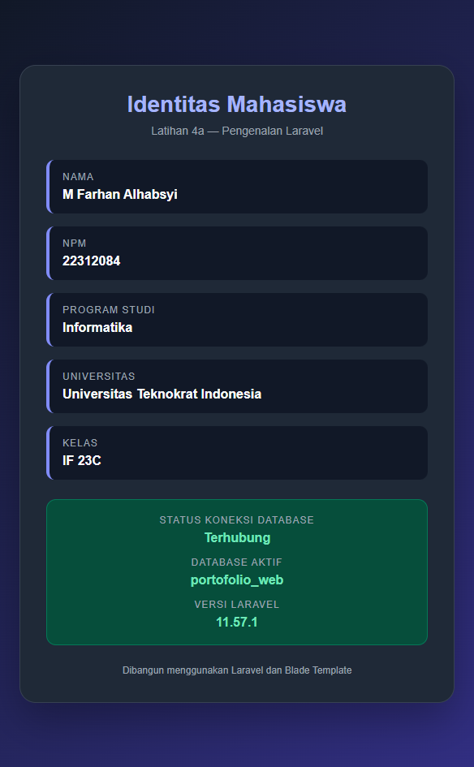

# Latihan 4a — Setup Laravel

## Identitas Mahasiswa

- **Nama:** M Farhan Alhabsyi
- **NPM:** 22312084
- **Program Studi:** Informatika
- **Universitas:** Universitas Teknokrat Indonesia
- **Kelas:** IF 23C

## Deskripsi

Latihan ini merupakan pengenalan framework Laravel dengan membuat project Laravel, mengatur koneksi database MySQL, memahami struktur folder Laravel, serta menampilkan halaman identitas mahasiswa menggunakan Controller dan Blade Template.

Halaman identitas menampilkan informasi mahasiswa, versi Laravel, status koneksi database, dan nama database yang sedang digunakan.

## Teknologi dan Versi

| Teknologi | Versi |
|---|---|
| PHP | 8.2.12 |
| Laravel | 11.57.1 |
| Database | MySQL |
| Template Engine | Blade |

### Alasan Memilih Versi

PHP 8.2 dipilih karena kompatibel dengan Laravel 11 dan tersedia pada lingkungan pengembangan XAMPP yang digunakan.

Laravel 11 dipilih karena merupakan framework PHP modern yang memiliki struktur MVC, routing, controller, Blade Template, serta fitur migration untuk pengelolaan database.

Versi tersebut sesuai untuk mempelajari dasar pengembangan aplikasi web menggunakan Laravel.

## Struktur Folder Laravel

| Folder | Fungsi |
|---|---|
| `app/` | Menyimpan kode utama aplikasi, seperti Controller, Model, dan logika aplikasi. |
| `bootstrap/` | Berisi proses awal aplikasi Laravel dan konfigurasi bootstrap. |
| `config/` | Menyimpan file konfigurasi aplikasi, database, mail, dan layanan lainnya. |
| `database/` | Menyimpan migration, seeder, dan factory untuk pengelolaan database. |
| `public/` | Direktori publik yang menjadi titik masuk aplikasi web melalui `index.php`. |
| `resources/` | Menyimpan view Blade, file CSS, JavaScript, dan sumber daya aplikasi. |
| `routes/` | Menyimpan definisi route atau alamat URL aplikasi. |
| `storage/` | Menyimpan log, cache, file session, dan file hasil proses aplikasi. |
| `tests/` | Menyimpan file pengujian aplikasi. |
| `vendor/` | Berisi library dan dependency PHP yang dipasang melalui Composer. |

## Perintah Artisan

Berikut beberapa perintah Artisan yang digunakan dalam pengembangan aplikasi Laravel:

| Perintah | Fungsi |
|---|---|
| `php artisan serve` | Menjalankan server pengembangan Laravel. |
| `php artisan make:controller HomeController` | Membuat Controller baru. |
| `php artisan route:list` | Menampilkan daftar route aplikasi. |
| `php artisan migrate` | Menjalankan migration untuk membuat atau memperbarui struktur database. |
| `php artisan migrate:status` | Memeriksa status migration yang sudah dijalankan. |
| `php artisan config:clear` | Menghapus cache konfigurasi Laravel. |
| `php artisan about` | Menampilkan informasi lingkungan dan konfigurasi aplikasi. |

## Database

Nama database yang digunakan:

`portofolio_web`

Koneksi database dikonfigurasi melalui file `.env`.

File `.env` tidak disertakan ke repository karena berisi konfigurasi lokal dan informasi sensitif. Repository menyediakan `.env.example` sebagai template konfigurasi.

## Screenshot

### Halaman Welcome dan Identitas Mahasiswa

Screenshot full page menampilkan identitas mahasiswa, status koneksi database, nama database aktif, dan versi Laravel.



## Menjalankan Project

1. Clone repository:

   ```bash
   git clone https://github.com/farhanalhabsyi/portofolio-farhan.git
   ```

2. Masuk ke folder project Laravel:

   ```bash
   cd portofolio-farhan/portofolio-web
   ```

3. Install dependency:

   ```bash
   composer install
   ```

4. Salin file konfigurasi `.env.example` menjadi `.env` menggunakan PowerShell:

   ```powershell
   Copy-Item .env.example .env
   ```

5. Buat database MySQL bernama `portofolio_web` melalui phpMyAdmin.

6. Sesuaikan konfigurasi database pada file `.env` dengan pengaturan MySQL lokal.

7. Buat application key:

   ```bash
   php artisan key:generate
   ```

8. Jalankan migration:

   ```bash
   php artisan migrate
   ```

9. Jalankan server Laravel:

   ```bash
   php artisan serve
   ```

10. Buka aplikasi melalui browser:

    `http://127.0.0.1:8000`